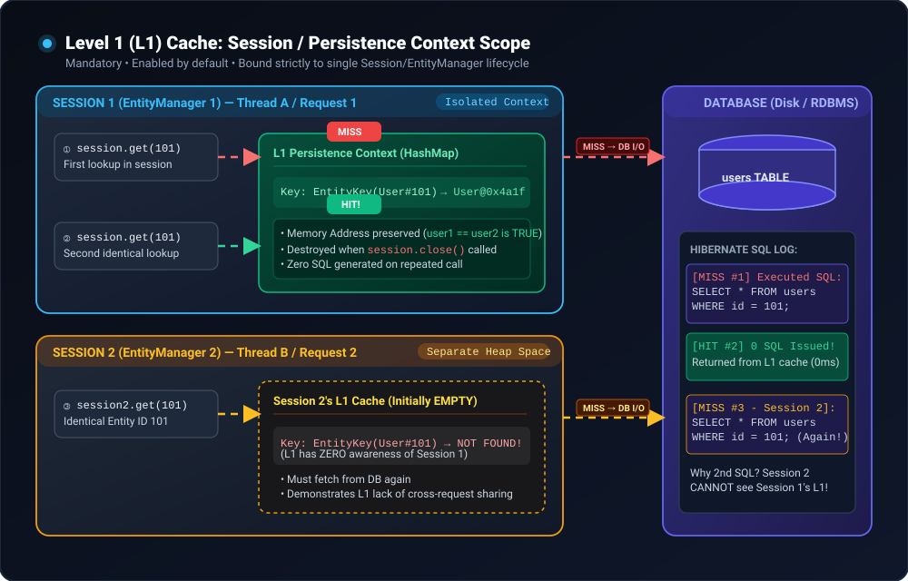
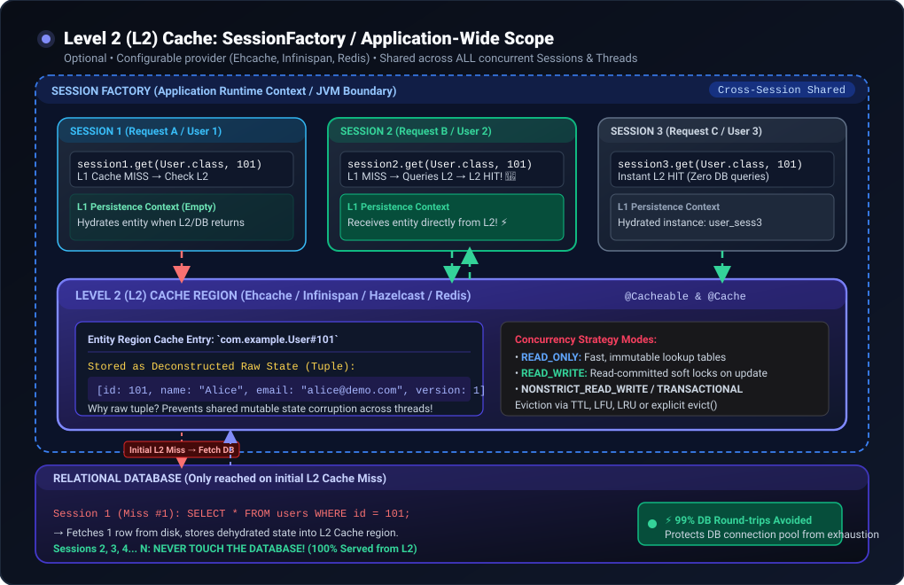
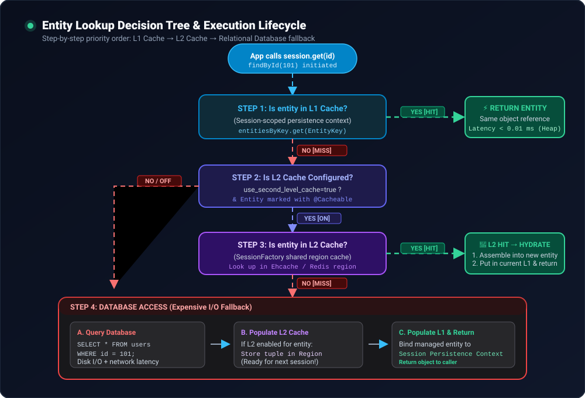
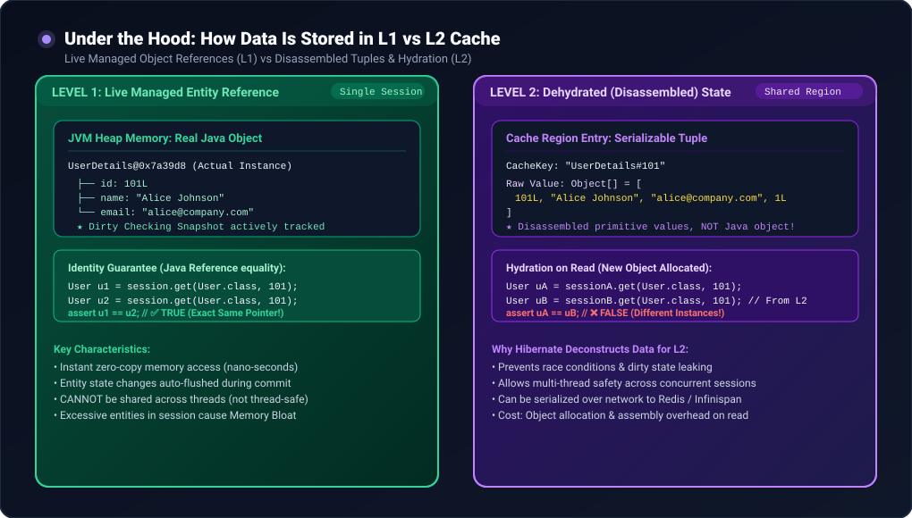

# 🚀 Hibernate Caching Demystified: Level 1 (L1) vs Level 2 (L2) Cache

> 📖 **Reference:** Inspired by and based on [*Hibernate Caching Demystified: Level 1 vs Level 2 Cache Explained* by akcoding](https://akcoding.medium.com/hibernate-caching-demystified-level-1-vs-level-2-cache-explained-5ccd389a1d5d).
>
> 💡 **Core Philosophy:** Hibernate caching bridges the object-relational impedance mismatch by eliminating redundant database round-trips, conserving database connection pools, and slashing application read latencies from milliseconds down to nanoseconds.

---

## 📑 Table of Contents
1. [Overview & Why Caching Matters](#1-overview--why-caching-matters)
2. [Level 1 (L1) Cache: Session / Persistence Context Scope](#2-level-1-l1-cache-session--persistence-context-scope)
3. [Level 2 (L2) Cache: SessionFactory / Application Scope](#3-level-2-l2-cache-sessionfactory--application-scope)
4. [Step-by-Step Lookup Decision Lifecycle](#4-step-by-step-lookup-decision-lifecycle)
5. [Under the Hood: How Data Is Stored in Memory](#5-under-the-hood-how-data-is-stored-in-memory)
6. [L1 vs L2: Comprehensive Comparison Matrix](#6-l1-vs-l2-comprehensive-comparison-matrix)
7. [The Hibernate Query Cache (L2 Companion)](#7-the-hibernate-query-cache-l2-companion)
8. [Hands-On Spring Boot Configuration & Code Example](#8-hands-on-spring-boot-configuration--code-example)
9. [Production Best Practices, Traps & Eviction Strategies](#9-production-best-practices-traps--eviction-strategies)
10. [Top Interview Questions & Rapid Answers](#10-top-interview-questions--rapid-answers)

---

## 1. Overview & Why Caching Matters

In enterprise Java applications, database queries (I/O operations, network serialization, socket connections, disk seeks, and row locking) are by far the slowest operations.

Hibernate provides a **two-tier caching architecture**:
- **First-Level Cache (L1):** Mandatory, built-in, and transactional. It eliminates duplicate queries within the same business transaction / HTTP request.
- **Second-Level Cache (L2):** Optional, configurable, and shared. It eliminates duplicate queries across different users, sessions, and HTTP requests across the entire application runtime.

---

## 2. Level 1 (L1) Cache: Session / Persistence Context Scope

The **First-Level Cache** is bound directly to the Hibernate `Session` (or JPA `EntityManager`). It is an in-memory hash map that tracks every entity managed by the current persistence context.

### 🔑 Key Characteristics of L1 Cache:
- **Always Active:** Enabled by default; it **cannot** be disabled.
- **Scope:** Local to the current `Session` / `EntityManager` (typically tied to one HTTP request or `@Transactional` boundary).
- **Thread Safety:** Bound to a single thread; **never shared** between concurrent requests.
- **Referential Identity:** Guarantees that within a session, multiple lookups for the same primary key return the exact same Java object reference (`u1 == u2` evaluates to `true`).
- **Lifecycle:** Starts when the `Session` opens; discarded when the `Session` closes.

### 🎬 Animated Architecture & Execution Flow (L1 Cache)



### 🔍 How L1 Cache Lookup Works:
1. When code calls `session.get(UserDetails.class, 101L)` or `repository.findById(101L)`, Hibernate inspects the session's internal `StatefulPersistenceContext.entitiesByKey` map.
2. **First Call (Cache Miss):** Entity is absent. Hibernate generates and executes `SELECT * FROM users WHERE id = 101`, converts the result set into an entity instance, puts it into the L1 map, and returns it.
3. **Second Call in Same Session (Cache Hit):** Hibernate finds `UserDetails#101` in the map and immediately returns the existing Java object reference. **Zero SQL queries are issued.**
4. **Different Session / Request:** When Session 2 calls for ID `101`, Session 2's L1 cache is initially empty. Because L1 caches are isolated, **Session 2 must execute another SQL query** against the database.

### 🧹 Managing L1 Cache & Preventing OutOfMemoryErrors:
Because L1 retains all managed entities in memory until the session ends, processing thousands of records in a single batch will exhaust heap space. You must explicitly clear or detach entities:

```java
// Evict a single specific entity from L1
session.evict(user); 
// or JPA: entityManager.detach(user);

// Clear the entire L1 cache for the current session
session.clear();
// or JPA: entityManager.clear();

// Check if an entity is currently managed in L1
boolean isCached = session.contains(user);
```

---

## 3. Level 2 (L2) Cache: SessionFactory / Application Scope

The **Second-Level Cache** sits above individual sessions at the `SessionFactory` (or JPA `EntityManagerFactory`) level. It lives for the entire application lifecycle and is shared across all threads and user requests.

### 🔑 Key Characteristics of L2 Cache:
- **Optional & Configurable:** Disabled by default. Requires explicit dependencies (e.g., Ehcache, Infinispan, Redisson) and configuration.
- **Scope:** Application-wide (JVM-wide or distributed cluster).
- **Thread Safety:** Thread-safe and shared across concurrent requests.
- **Entity Selection:** Entities must be explicitly marked as cacheable using `@Cacheable` and `@Cache`.
- **Lifecycle:** Persists beyond individual transactions and sessions until evicted by TTL (Time-To-Live), LRU/LFU policy, or manual invalidation.

### 🎬 Animated Architecture & Multi-Session Sharing (L2 Cache)



### ⚙️ L2 Cache Concurrency Strategies (`@Cache`)

When multiple threads concurrently read and mutate cached data, Hibernate uses concurrency strategies to prevent data corruption:

| Concurrency Strategy | Best Used For | Behavior on Update / Concurrency |
| :--- | :--- | :--- |
| **`READ_ONLY`** | Static reference data (countries, currency codes, postal codes) | Throws `UnsupportedOperationException` if an update is attempted. Fastest performance. |
| **`READ_WRITE`** | Read-heavy data with occasional updates | Uses soft locks during transactions (read committed isolation). Updates temporarily lock the cache key until commit. |
| **`NONSTRICT_READ_WRITE`** | Data rarely updated, small risk of stale reads acceptable | Does not lock the cache. On update, invalidates the entry after transaction commit. |
| **`TRANSACTIONAL`** | Strict JTA enterprise environments | Full 2-phase commit (2PC) distributed locking (e.g., with Infinispan). |

---

## 4. Step-by-Step Lookup Decision Lifecycle

When your application requests an entity, Hibernate executes a strict hierarchy of checks before resorting to database disk I/O.

### 🎬 Animated Decision Tree (L1 → L2 → Database)



### 📋 Lookup Sequence Explained:
1. **Step 1 — L1 Cache Check:** Hibernate inspects the current session's `PersistenceContext`.
   - **HIT:** Return live entity instance immediately. **(Time: ~10 ns)**
   - **MISS:** Proceed to Step 2.
2. **Step 2 — L2 Cache Check:** Is second-level caching enabled and is this entity marked `@Cacheable`?
   - **NO:** Skip directly to database query (Step 4).
   - **YES:** Proceed to Step 3.
3. **Step 3 — L2 Region Inspection:** Hibernate queries the configured cache provider (e.g., Ehcache / Redis region).
   - **HIT:** Dehydrated data tuple retrieved from L2. Hibernate instantiates a brand new entity object, binds it to the current session's L1 cache, and returns it. **(Time: ~0.1 - 1 ms, Zero DB Queries!)**
   - **MISS:** Proceed to Step 4.
4. **Step 4 — Database Query (Fallback):**
   - Hibernate executes SQL `SELECT` against the database.
   - If L2 is enabled, Hibernate disassembles the row data and populates the L2 cache region.
   - Hibernate creates the entity, stores it in the current session's L1 cache, and returns it. **(Time: ~5 - 50 ms)**

---

## 5. Under the Hood: How Data Is Stored in Memory

One of the biggest architectural differences between L1 and L2 is **what is actually stored in memory**:

### 🎬 Animated Storage Comparison (Live Reference vs Dehydrated Tuple)



### 🧪 Live Objects vs. Dehydrated Tuples:
- **In L1 Cache:**
  - Stores the **exact live Java entity instance**.
  - `User u1 = session.get(User.class, 101);`
  - `User u2 = session.get(User.class, 101);`
  - `u1 == u2` is **`true`** (exact same memory pointer).
- **In L2 Cache:**
  - Stores a **deconstructed / dehydrated array of primitive values and identifiers** (e.g., `Object[] { 101L, "Alice", "alice@example.com", 1 }`), NOT the Java entity instance.
  - **Why?** If L2 stored live Java instances, two concurrent threads could modify the same object simultaneously without transaction boundaries, causing severe race conditions and dirty reads.
  - When Session B reads from L2, Hibernate **hydrates** (constructs) a *new* entity instance.
  - `User uA = sessionA.get(User.class, 101);`
  - `User uB = sessionB.get(User.class, 101);`
  - `uA == uB` is **`false`** (distinct instances), but `uA.equals(uB)` is **`true`**!

---

## 6. L1 vs L2: Comprehensive Comparison Matrix

| Feature | Level 1 (L1) Cache | Level 2 (L2) Cache |
| :--- | :--- | :--- |
| **Scope** | `Session` / `EntityManager` | `SessionFactory` / `EntityManagerFactory` |
| **Default State** | **Enabled by default** (Mandatory) | **Disabled by default** (Optional) |
| **Can it be disabled?** | ❌ No | ✅ Yes |
| **Lifetime** | Lives and dies with the Session/Transaction | Application runtime / Until evicted |
| **Thread Safety** | Thread-confined (Not shared across threads) | Thread-safe (Shared across all sessions & threads) |
| **Storage Structure** | Live Java Entity Objects in Heap | Dehydrated Tuples / Serialized state |
| **Referential Equality** | `u1 == u2` is `true` (same pointer) | `uA == uB` is `false` (hydrated per session) |
| **Configuration** | Zero config required | Requires provider jar + configuration + annotations |
| **Popular Providers** | Internal (`StatefulPersistenceContext`) | Ehcache, Infinispan, Hazelcast, Redis/Redisson |
| **Eviction APIs** | `session.evict(e)`, `session.clear()` | `sessionFactory.getCache().evictEntity(User.class, id)` |
| **Query Cache Support** | N/A (query results go to L1) | Works directly with Hibernate Query Cache |
| **Clustered / Distributed** | ❌ No | ✅ Yes (with distributed providers like Infinispan/Redis) |

---

## 7. The Hibernate Query Cache (L2 Companion)

While L2 caches entities by **Primary Key** (`id`), it does **not** cache arbitrary JPQL / HQL query results by default (e.g., `SELECT u FROM User u WHERE u.age > 25`).

That is handled by the **Query Cache**:
- The Query Cache stores **only the entity IDs** matching the query predicate, not the actual entity data.
- When the query runs again, Hibernate pulls the IDs from the Query Cache and then fetches the entities from the **L2 Cache**.
- **Important:** If L2 is disabled, the Query Cache will result in **N+1 queries** (1 query to fetch IDs + N individual queries to fetch each entity from the DB)!

```properties
# Enable Hibernate Query Cache
spring.jpa.properties.hibernate.cache.use_query_cache=true
```

In code:
```java
Query query = session.createQuery("FROM UserDetails u WHERE u.status = :status");
query.setParameter("status", "ACTIVE");
query.setHint(org.hibernate.jpa.AvailableHints.HINT_CACHEABLE, true);
List<UserDetails> users = query.getResultList();
```

---

## 8. Hands-On Spring Boot Configuration & Code Example

### Step 1: Add Dependencies (`pom.xml`)

```xml
<!-- Hibernate JCache & Ehcache 3 -->
<dependency>
    <groupId>org.hibernate.orm</groupId>
    <artifactId>hibernate-jcache</artifactId>
</dependency>
<dependency>
    <groupId>org.ehcache</groupId>
    <artifactId>ehcache</artifactId>
    <classifier>jakarta</classifier>
</dependency>
```

### Step 2: Configure Properties (`application.properties` or `application.yml`)

```properties
# Enable Second-Level Cache
spring.jpa.properties.hibernate.cache.use_second_level_cache=true

# Specify Cache Region Factory (JCache implementation)
spring.jpa.properties.hibernate.cache.region.factory_class=org.hibernate.cache.jcache.JCacheRegionFactory

# Path to Ehcache XML config
spring.jpa.properties.hibernate.javax.cache.provider=org.ehcache.jsr107.EhcacheCachingProvider
spring.jpa.properties.hibernate.javax.cache.uri=classpath:ehcache.xml

# Enable SQL & statistics logging to observe cache hits vs misses
spring.jpa.show-sql=true
spring.jpa.properties.hibernate.format_sql=true
spring.jpa.properties.hibernate.generate_statistics=true
```

### Step 3: Configure Cache Regions (`src/main/resources/ehcache.xml`)

```xml
<config xmlns:xsi="http://www.w3.org/2001/XMLSchema-instance"
        xmlns="http://www.ehcache.org/v3"
        xsi:schemaLocation="http://www.ehcache.org/v3 http://www.ehcache.org/schema/ehcache-107-ext-3.0.xsd">

    <cache alias="com.example.entity.UserDetails">
        <key-type>java.lang.Long</key-type>
        <value-type>java.lang.Object</value-type>
        <expiry>
            <ttl unit="minutes">60</ttl>
        </expiry>
        <resources>
            <heap unit="entries">2000</heap>
        </resources>
    </cache>
</config>
```

### Step 4: Annotate Entity with `@Cacheable` and `@Cache`

```java
package com.example.entity;

import jakarta.persistence.*;
import org.hibernate.annotations.Cache;
import org.hibernate.annotations.CacheConcurrencyStrategy;

@Entity
@Table(name = "user_details")
@Cacheable
@Cache(usage = CacheConcurrencyStrategy.READ_WRITE, region = "com.example.entity.UserDetails")
public class UserDetails {

    @Id
    @GeneratedValue(strategy = GenerationType.IDENTITY)
    private Long id;

    private String name;
    private String email;

    public UserDetails() {}

    public UserDetails(String name, String email) {
        this.name = name;
        this.email = email;
    }

    // Getters and Setters...
    public Long getId() { return id; }
    public String getName() { return name; }
    public String getEmail() { return email; }
}
```

### Step 5: Test Verification

```java
@Service
public class UserService {

    @Autowired
    private UserRepository userRepository;

    // Call 1: New HTTP Request / Session 1
    public UserDetails fetchInRequestA(Long id) {
        return userRepository.findById(id).orElse(null); // Triggers SQL, caches in L2
    }

    // Call 2: Different HTTP Request / Session 2
    public UserDetails fetchInRequestB(Long id) {
        return userRepository.findById(id).orElse(null); // L2 HIT! ZERO SQL generated!
    }
}
```

---

## 9. Production Best Practices, Traps & Eviction Strategies

### ✅ When to Use L2 Cache:
1. **Read-Heavy, Infrequently Mutated Entities:** Lookup tables, roles, configuration parameters, countries, categories.
2. **High-Frequency Primary Key Reads:** Entities repeatedly queried by `findById()`.
3. **Controlled Updates:** Entities modified through Hibernate ORM (not bulk native SQL).

### ❌ When NOT to Use L2 Cache:
1. **Write-Heavy Entities:** Frequent updates cause continuous cache invalidations and lock contention.
2. **Direct Database Updates:** If external cron jobs, ETL pipelines, or native SQL queries modify rows directly, the L2 cache becomes **stale and inconsistent**.
3. **Multi-Instance Microservices without Distributed Caching:** If 5 instances use JVM-local Ehcache, Instance A won't know when Instance B updates a row! Use **Redis / Infinispan** in clustered mode for multi-node architectures.

### 🛑 Handling Large Batch Processing in L1:
```java
// Anti-pattern: Loading 50,000 entities in one session -> OutOfMemoryError!
// Solution: Periodic Flush & Clear
for (int i = 0; i < entities.size(); i++) {
    entityManager.persist(entities.get(i));
    if (i % 50 == 0) {
        entityManager.flush(); // Sends SQL INSERTs to DB
        entityManager.clear(); // Empties L1 cache to reclaim heap
    }
}
```

### 🧹 Programmatic L2 Eviction:
```java
// Evict specific entity from L2
sessionFactory.getCache().evict(UserDetails.class, 101L);

// Evict all entities of a type
sessionFactory.getCache().evict(UserDetails.class);

// Evict entire L2 cache
sessionFactory.getCache().evictAllRegions();
```

---

## 10. Top Interview Questions & Rapid Answers

### Q1: Can we disable Hibernate First-Level Cache?
> **Answer:** **No.** The First-Level cache is an inseparable part of Hibernate's persistence context. It is required to guarantee referential identity within a transaction and prevent circular reference infinite loops.

### Q2: Why does L2 Cache store dehydrated tuples instead of live Java objects?
> **Answer:** To prevent thread-concurrency hazards. If L2 stored live Java objects, multiple threads from different sessions would mutate the same object without transactional isolation. Dehydrated tuples allow Hibernate to hydrate a clean, isolated entity instance for each requesting session.

### Q3: What happens if I update data using a Native SQL Query (`@Modifying`)?
> **Answer:** Native queries execute directly against the database, bypassing Hibernate's entity interceptors. This leaves the L2 cache **stale**. You must explicitly call `sessionFactory.getCache().evict(...)` or annotate the method with `@Modifying(clearAutomatically = true)` to clear L1 and invalidate relevant regions.

### Q4: What is the difference between Hibernate L2 Cache and Redis Cache?
> **Answer:** 
> - **Hibernate L2 Cache:** ORM-specific, transparently caches entity and query results, handles entity relational graphs and automatic dirty invalidations.
> - **Redis Cache:** Standalone external distributed key-value store. Caches arbitrary data (DTOs, JSON, session state) application-wide across microservice boundaries.
