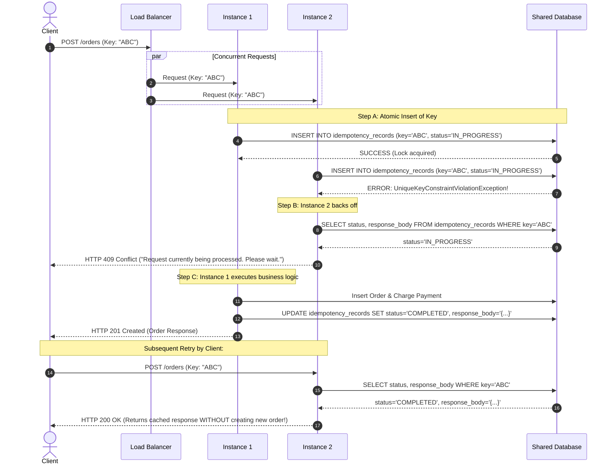

# Spring Boot Scenario-Based Interview Questions (SDE-2 / SDE-3)

Real-world "what would you do if…" questions asked in backend (Java / Spring Boot) interviews, answered the way you would answer **in the interview room**: clarify → diagnose → fix → trade-offs → prevent.

> **About "Asked at":** company names come from **candidate-reported** interview experiences (LeetCode Discuss, Glassdoor, Medium, GeeksforGeeks, interview-prep sites). They're anecdotes, not official question banks: teams, years and levels differ. Where no report names a company, the scenario is marked **"Commonly asked"** (it appears across many prep sources, but no company was verified). All links are in [Sources](#sources) at the end.

## How to answer any scenario question


1. **Clarify** (30 seconds): scale (req/s, data size), latency target, consistency needs, what already exists. Interviewers reward questions that change the design.
2. **Diagnose before fixing:** say which metric, log, trace or dump you'd look at first, and why.
3. **Quick fix:** how you'd stop the bleeding right now (rollback, scale, feature flag off, raise a limit).
4. **Real fix:** the design + code. **Name the pattern** (idempotency key, outbox, saga, CAS, circuit breaker).
5. **Trade-offs:** what it costs (consistency vs latency, extra infrastructure, complexity).
6. **Prevent recurrence:** alerts, tests, limits, runbook.

**SDE-2 bar:** correct diagnosis + working fix + clean code. **SDE-3 bar:** plus trade-offs, failure modes, safe rollout, and how the team avoids it next time.

## Scenario index

| # | Scenario | Reported at (candidate reports) | Topic |
|---|---|---|---|
| 1 | Nested external API calls in a loop (distributed N+1) | Commonly asked | Performance, batching, async |
| 2 | Aggregating orders → products → cost API | Commonly asked | Batching, caching, fan-out |
| 3 | Duplicate orders across instances (idempotency) | Razorpay (prep guides call it the #1 topic), PayU SDE-2 (Kafka idempotency), Airtel (payments scenarios) | Idempotency, distributed locks |
| 4 | Flash sale: prevent overselling | **Flipkart SDE-2** (2026 reports) | Concurrency, inventory |
| 5 | `@Transactional` not rolling back | Airtel (`@Transactional` + isolation levels); commonly asked | Spring proxies, transactions |
| 6 | Kafka: duplicate events, ordering, consumer lag | **PayU SDE-2**, **Walmart** SWE-III / SDE-3, **Paytm** senior, **Swiggy** SDE-2 | Messaging |
| 7 | Order + payment + inventory consistency across services | **Flipkart** senior SWE, **Airtel**; commonly asked | Saga, outbox |
| 8 | Rate limiting an API | **Razorpay** (rate-limiter design), **Paytm** senior | Rate limiting |
| 9 | Downstream service is slow / down | **Walmart** (resiliency round), **Paytm** senior | Timeouts, retries, circuit breaker |
| 10 | API fast locally, slow in production | **Paytm** (Grafana/Prometheus), **PayU** (profiling); commonly asked | Observability |
| 11 | DB connection pool exhausted | Commonly asked | HikariCP, transactions |
| 12 | Added more pods, still slow | Commonly asked | Scaling, bottlenecks |
| 13 | Two users book the same slot / edit the same row | **Swiggy** (prep guide: "two users book the same slot") | Locking |
| 14 | Cache stampede / stale cache | **Paytm** (caching, Redis), **Airtel** (Redis) | Caching |
| 15 | OutOfMemoryError / pod OOMKilled | **Paytm** (GC internals); commonly asked | JVM, Kubernetes |
| 16 | Add a new payment method without changing code | **Paytm** (why beans are interfaces → strategy), **CRED** SDE-2 (payment machine coding), **Swiggy** (strategy for discounts) | LLD, Spring DI |
| 17 | Rename a column / deploy with zero downtime | Commonly asked (senior) | Migrations, deployments |
| 18 | Securing APIs and actuator in production | **Paytm** (auth mechanisms, JWT), **PayU** / Glassdoor (Actuator) | Security |
| 19 | Consistent error handling across the API | **PayU** SDE-2, **Airtel** (`@ControllerAdvice`) | Exception handling |
| 20 | "Tell me about a production incident you handled" | **Airtel** SDE-2 (advice: prepare a real incident story) | Behavioural + technical |

---

# Scenario 1: Optimizing Nested External API Calls (User -> Address -> City)

---

## 1. The Scenario & The Problem

You fetch a `List<User>`, where each `User` contains a `List<Address>`. While converting them into a response DTO, you need city details for each address by calling an external client: `addressClient.getCity(addressId)`.

### The Naive / Problematic Implementation

```java
@Service
public class UserService {

    @Autowired
    private UserRepository userRepository;

    @Autowired
    private AddressClient addressClient; // External REST / Feign / WebClient

    public List<UserResponseDTO> getUsersWithCityDetails() {
        List<User> users = userRepository.findAll();

        List<UserResponseDTO> responseList = new ArrayList<>();

        for (User user : users) {
            List<AddressDTO> addressDTOs = new ArrayList<>();

            for (Address address : user.getAddresses()) {
                // ⚠️ THE TRAP: Calling external HTTP service in a nested loop!
                CityDTO city = addressClient.getCity(address.getId());

                AddressDTO addressDTO = new AddressDTO(address.getId(), address.getStreet(), city);
                addressDTOs.add(addressDTO);
            }

            responseList.add(new UserResponseDTO(user.getId(), user.getName(), addressDTOs));
        }

        return responseList;
    }
}
```

---

### Why This Destroys Performance ("Distributed N+1 Problem")

Assume:
- 100 Users
- Each User has an average of 2 Addresses (200 addresses total)
- External `addressClient.getCity()` takes **50ms** per HTTP call (network latency + processing)

$$\text{Total Time} = 200 \times 50\text{ ms} = 10,000\text{ ms} = \mathbf{10\text{ seconds!}}$$

#### Additional Hidden Issues:
1. **Duplicate Network Calls:** If 50 addresses belong to the same city or share IDs, you are fetching the exact same data repeatedly over the network.
2. **Connection Pool Starvation:** Synchronous HTTP clients (like `RestTemplate` or default `HttpClient`) tie up connection pool slots and worker threads.
3. **Cascading Failures & Rate Limits:** Hammering the external service with hundreds of calls per incoming request triggers HTTP 429 (Too Many Requests) or external service outages.

---

## 2. Optimization Strategies

---

### Strategy 1: Batch / Bulk API Endpoint (The Best & Recommended Solution)

Instead of calling the external service 1-by-1 in a loop, extract all unique IDs and make **one single bulk HTTP call**.

#### Step 1: Collect Unique IDs
```java
// Extract unique address IDs across all users
Set<Long> uniqueAddressIds = users.stream()
        .flatMap(u -> u.getAddresses().stream())
        .map(Address::getId)
        .collect(Collectors.toSet());
```

#### Step 2: Call Bulk Endpoint Once
```java
// 1 network call instead of 200!
// Map<AddressId, CityDTO>
Map<Long, CityDTO> cityMap = addressClient.getCitiesByAddressIds(uniqueAddressIds);
```

#### Step 3: Stitch Data in Memory (O(1) lookup)
```java
public List<UserResponseDTO> getUsersOptimizedBatch() {
    List<User> users = userRepository.findAll();

    // 1. Gather all unique address IDs
    Set<Long> addressIds = users.stream()
            .flatMap(user -> user.getAddresses().stream())
            .map(Address::getId)
            .collect(Collectors.toSet());

    // 2. Fetch in a single batch call
    Map<Long, CityDTO> cityMap = addressClient.getCitiesByAddressIds(addressIds);

    // 3. Assemble DTOs in memory
    return users.stream().map(user -> {
        List<AddressDTO> addressDTOs = user.getAddresses().stream().map(address -> {
            CityDTO city = cityMap.get(address.getId());
            return new AddressDTO(address.getId(), address.getStreet(), city);
        }).toList();

        return new UserResponseDTO(user.getId(), user.getName(), addressDTOs);
    }).toList();
}
```

> **Performance Gain:** 200 requests (10s) $\rightarrow$ **1 request (~80ms)**.

---

### Strategy 2: Caching (Redis or In-Memory Caffeine)

City and address mapping data is usually static and rarely changes. Caching prevents redundant network hops.

#### Option A: Spring `@Cacheable` on the Client
```java
@Component
public class CachedAddressClient {

    @Autowired
    private AddressClient addressClient;

    // Results cached in Redis / Caffeine with TTL (e.g., 1 hour)
    @Cacheable(value = "cityCache", key = "#addressId", unless = "#result == null")
    public CityDTO getCity(Long addressId) {
        return addressClient.getCity(addressId);
    }
}
```

#### Option B: Bulk Caching with Redis MGET
If using batching, you can:
1. Check Redis for cached IDs using `MGET`.
2. Only call `addressClient.getCitiesByAddressIds(...)` for IDs that had a cache miss.
3. Save missing results back to Redis with `MSET`.

---

### Strategy 3: Parallel / Asynchronous Calls (`CompletableFuture` or Virtual Threads)

What if the external team **refuses** or **cannot provide a batch endpoint**?
You can fan-out the requests concurrently instead of waiting sequentially.

#### Using `CompletableFuture` with a Dedicated Custom Thread Pool

> ⚠️ **Important:** Never use the default `ForkJoinPool.commonPool()` for blocking I/O calls. Use a dedicated `ExecutorService`.

```java
@Service
public class UserService {

    @Autowired
    private AddressClient addressClient;

    @Autowired
    @Qualifier("externalApiExecutor")
    private Executor externalApiExecutor;

    public List<UserResponseDTO> getUsersParallel() {
        List<User> users = userRepository.findAll();

        // 1. Extract unique address IDs to avoid duplicate calls
        Set<Long> uniqueIds = users.stream()
                .flatMap(u -> u.getAddresses().stream())
                .map(Address::getId)
                .collect(Collectors.toSet());

        // 2. Fire calls concurrently in the dedicated thread pool
        Map<Long, CompletableFuture<CityDTO>> futuresMap = uniqueIds.stream()
                .collect(Collectors.toMap(
                        id -> id,
                        id -> CompletableFuture.supplyAsync(() -> addressClient.getCity(id), externalApiExecutor)
                                .exceptionally(ex -> fallbackCity(id, ex)) // Error handling / Fallback
                ));

        // 3. Wait for all futures to finish
        CompletableFuture.allOf(futuresMap.values().toArray(new CompletableFuture[0])).join();

        // 4. Extract results into Map<Long, CityDTO>
        Map<Long, CityDTO> cityMap = futuresMap.entrySet().stream()
                .collect(Collectors.toMap(
                        Map.Entry::getKey,
                        entry -> entry.getValue().join()
                ));

        // 5. In-memory assembly
        return mapToUserDTOs(users, cityMap);
    }
}
```

#### Configuration for Dedicated Thread Pool:
```java
@Configuration
public class AsyncConfig {

    @Bean("externalApiExecutor")
    public Executor externalApiExecutor() {
        ThreadPoolTaskExecutor executor = new ThreadPoolTaskExecutor();
        executor.setCorePoolSize(20);
        executor.setMaxPoolSize(50);
        executor.setQueueCapacity(200);
        executor.setThreadNamePrefix("ExtCityApi-");
        executor.initialize();
        return executor;
    }
}
```

#### Using Java 21 Virtual Threads (Project Loom)
If on Java 21+, virtual threads make concurrent blocking I/O lightweight without thread pool overhead:
```java
try (var executor = Executors.newVirtualThreadPerTaskExecutor()) {
    List<Future<Pair<Long, CityDTO>>> futures = uniqueIds.stream()
        .map(id -> executor.submit(() -> Pair.of(id, addressClient.getCity(id))))
        .toList();

    Map<Long, CityDTO> cityMap = new HashMap<>();
    for (var future : futures) {
        Pair<Long, CityDTO> pair = future.get();
        cityMap.put(pair.getFirst(), pair.getSecond());
    }
}
```

---

### Strategy 4: Reactive Non-Blocking Streams (Spring WebFlux / WebClient)

If your stack uses Spring WebFlux, you can use reactive streams with concurrency controls:

```java
public Mono<List<UserResponseDTO>> getUsersReactive() {
    return userRepository.findAllUsers()
        .collectList()
        .flatMap(users -> {
            Set<Long> uniqueIds = users.stream()
                    .flatMap(u -> u.getAddresses().stream())
                    .map(Address::getId)
                    .collect(Collectors.toSet());

            return Flux.fromIterable(uniqueIds)
                    // flatMap with concurrency limit to prevent overwhelming external service
                    .flatMap(id -> webClient.get()
                            .uri("/cities/{id}", id)
                            .retrieve()
                            .bodyToMono(CityDTO.class)
                            .map(city -> Map.entry(id, city)), 20) 
                    .collectMap(Map.Entry::getKey, Map.Entry::getValue)
                    .map(cityMap -> mapToUserDTOs(users, cityMap));
        });
}
```

---

### Strategy 5: Architectural Fixes (Data Sync & Denormalization)

If this data is fetched frequently on critical read paths:

1. **Denormalization / Local Replica:**
   - Store `city_name`, `state`, and `pincode` directly in your local `Address` entity/table.
   - Eliminates runtime HTTP dependencies completely.
2. **Event-Driven Synchronization (Kafka / RabbitMQ):**
   - Whenever an address or city is updated in the Address Service, publish an event: `AddressUpdatedEvent`.
   - Your service consumes the event and updates its local table or cache asynchronously.

---

## 3. Production Safeguards (Resilience4j)

External calls can hang, time out, or fail. When optimizing external calls:

1. **Strict Timeouts:**
   - Always set `connectTimeout` (e.g. 500ms) and `readTimeout` (e.g. 1500ms) on HTTP clients.
2. **Circuit Breaker & Fallback:**
   - Use Resilience4j `@CircuitBreaker(name = "addressService", fallbackMethod = "defaultCityFallback")`.
   - Return a default `CityDTO("UNKNOWN")` or cached value instead of failing the entire user request.
3. **Rate Limiting / Bulkhead:**
   - Limit maximum concurrent outgoing connections to avoid getting blocked by the external API provider.

---

## 4. Decision Matrix: Which One to Choose?

| Scenario | Best Choice | Expected Latency Reduction |
| :--- | :--- | :--- |
| External team can add a batch endpoint | **Strategy 1: Batch API** | 90% - 98% reduction |
| Data rarely changes / repetitive lookups | **Strategy 2: Redis / Caffeine Cache** | ~99% reduction on cache hits |
| External team cannot add batch API | **Strategy 3: CompletableFuture / Virtual Threads** | 75% - 85% reduction |
| Reactive Spring WebFlux microservice | **Strategy 4: WebClient + flatMap concurrency** | High throughput & non-blocking |
| High-traffic core business flow | **Strategy 5: Event-Driven Sync (Kafka)** | 100% reduction (Zero HTTP calls) |

---
---

# Scenario 2: Aggregating Order & Product Costs for a User (UserId -> Orders -> Products -> Cost API)

---

## 1. The Scenario & The Problem

You receive a `userId`. 
1. You fetch `List<Order>` for that user.
2. Each `Order` contains a `List<Product>` (each product has `productId` and `name`).
3. To calculate the cost, you must call an external client: `orderClient.getCost(productId, name)`.
4. **Goal:** Calculate:
   - The individual cost of each product.
   - The total cost of each order.
   - The grand total cost across all orders for the user.

---

### The Naive / Costly Implementation

```java
@Service
public class OrderCostService {

    @Autowired
    private OrderRepository orderRepository;

    @Autowired
    private OrderClient orderClient; // External pricing/cost service

    public UserTotalCostResponseDTO calculateUserOrdersCostNaive(Long userId) {
        List<Order> orders = orderRepository.findByUserId(userId);

        BigDecimal userGrandTotal = BigDecimal.ZERO;
        List<OrderCostDTO> orderCostDTOs = new ArrayList<>();

        for (Order order : orders) {
            BigDecimal orderTotal = BigDecimal.ZERO;
            List<ProductCostDTO> productDTOs = new ArrayList<>();

            for (Product product : order.getProducts()) {
                // ⚠️ THE TRAP 1: Sequential external HTTP call per product!
                // ⚠️ THE TRAP 2: What if product (ID: 101, "Mouse") appears in Order 1 AND Order 3?
                //                We call external service twice for the exact same item!
                BigDecimal cost = orderClient.getCost(product.getProductId(), product.getName());

                orderTotal = orderTotal.add(cost);
                productDTOs.add(new ProductCostDTO(product.getProductId(), product.getName(), cost));
            }

            userGrandTotal = userGrandTotal.add(orderTotal);
            orderCostDTOs.add(new OrderCostDTO(order.getId(), orderTotal, productDTOs));
        }

        return new UserTotalCostResponseDTO(userId, userGrandTotal, orderCostDTOs);
    }
}
```

---

### Why This Is Dangerous:
1. **Multiplied Latency:** If the user has 10 orders with 4 products each = **40 sequential HTTP calls**. At 100ms/call = **4 seconds** blocking thread time!
2. **Duplicate Calls for Same Products:** Users often re-order standard items (e.g. coffee, cables, accessories). Calling the external service multiple times for the identical `(productId, name)` wastes network bandwidth and pricing quota.
3. **Monetary Precision:** Always use `BigDecimal` instead of `double`/`float` to prevent IEEE 754 floating-point rounding errors on prices.

---

## 2. Key Pattern: Composite Key Deduplication

Notice that `getCost(productId, name)` takes **two** parameters (`productId` and `name`).
To deduplicate requests, define a Java `record` as a composite key:

```java
// Java Record gives built-in equals(), hashCode(), and toString()
public record ProductKey(Long productId, String name) {}
```

By collecting products into a `Set<ProductKey>`, identical products across all orders are automatically deduplicated into a single entry!

---

## 3. Step-by-Step Optimization Solutions

---

### Strategy 1: Batch Pricing API (Best Practice)

Request a batch endpoint from the pricing/order service:  
`POST /costs/batch` taking a list of `ProductKey` and returning `Map<ProductKey, BigDecimal>`.

```java
@Service
public class OrderCostService {

    @Autowired
    private OrderRepository orderRepository;

    @Autowired
    private OrderClient orderClient;

    public UserTotalCostResponseDTO calculateUserOrdersCostBatch(Long userId) {
        // 1. Fetch user orders
        List<Order> orders = orderRepository.findByUserId(userId);
        if (orders.isEmpty()) {
            return new UserTotalCostResponseDTO(userId, BigDecimal.ZERO, List.of());
        }

        // 2. Extract UNIQUE composite keys across ALL orders (Deduplication)
        Set<ProductKey> uniqueKeys = orders.stream()
                .flatMap(order -> order.getProducts().stream())
                .map(product -> new ProductKey(product.getProductId(), product.getName()))
                .collect(Collectors.toSet());

        // 3. Make ONE batch network call
        // Returns Map<ProductKey, BigDecimal>
        Map<ProductKey, BigDecimal> priceMap = orderClient.getCostsBatch(uniqueKeys);

        // 4. In-Memory Calculation (O(1) lookups)
        BigDecimal userGrandTotal = BigDecimal.ZERO;
        List<OrderCostDTO> orderCostDTOs = new ArrayList<>();

        for (Order order : orders) {
            BigDecimal orderTotal = BigDecimal.ZERO;
            List<ProductCostDTO> productDTOs = new ArrayList<>();

            for (Product product : order.getProducts()) {
                ProductKey key = new ProductKey(product.getProductId(), product.getName());
                BigDecimal cost = priceMap.getOrDefault(key, BigDecimal.ZERO);

                orderTotal = orderTotal.add(cost);
                productDTOs.add(new ProductCostDTO(product.getProductId(), product.getName(), cost));
            }

            userGrandTotal = userGrandTotal.add(orderTotal);
            orderCostDTOs.add(new OrderCostDTO(order.getId(), orderTotal, productDTOs));
        }

        return new UserTotalCostResponseDTO(userId, userGrandTotal, orderCostDTOs);
    }
}
```

---

### Strategy 2: Deduplicated Parallel Fan-Out (`CompletableFuture`)

If the external API **only** supports single queries `orderClient.getCost(id, name)`:
1. Deduplicate unique keys first (never make duplicate HTTP calls).
2. Query them all in parallel using a dedicated thread pool.
3. Stitch results into the orders.

```java
@Service
public class OrderCostService {

    @Autowired
    private OrderRepository orderRepository;

    @Autowired
    private OrderClient orderClient;

    @Autowired
    @Qualifier("pricingExecutor")
    private Executor pricingExecutor;

    public UserTotalCostResponseDTO calculateUserOrdersCostParallel(Long userId) {
        List<Order> orders = orderRepository.findByUserId(userId);
        if (orders.isEmpty()) {
            return new UserTotalCostResponseDTO(userId, BigDecimal.ZERO, List.of());
        }

        // 1. Deduplicate keys
        Set<ProductKey> uniqueKeys = orders.stream()
                .flatMap(order -> order.getProducts().stream())
                .map(p -> new ProductKey(p.getProductId(), p.getName()))
                .collect(Collectors.toSet());

        // 2. Fire concurrent calls ONLY for unique keys
        Map<ProductKey, CompletableFuture<BigDecimal>> futureMap = uniqueKeys.stream()
                .collect(Collectors.toMap(
                        key -> key,
                        key -> CompletableFuture.supplyAsync(
                                () -> orderClient.getCost(key.productId(), key.name()),
                                pricingExecutor
                        ).exceptionally(ex -> BigDecimal.ZERO) // Fallback on failure
                ));

        // 3. Wait for all parallel calls to complete
        CompletableFuture.allOf(futureMap.values().toArray(new CompletableFuture[0])).join();

        // 4. Resolve futures into Map<ProductKey, BigDecimal>
        Map<ProductKey, BigDecimal> priceMap = futureMap.entrySet().stream()
                .collect(Collectors.toMap(
                        Map.Entry::getKey,
                        entry -> entry.getValue().join()
                ));

        // 5. Aggregate order totals and user grand total
        return aggregateUserAndOrderTotals(userId, orders, priceMap);
    }
}
```

#### Dedicated Executor Configuration:
```java
@Bean("pricingExecutor")
public Executor pricingExecutor() {
    ThreadPoolTaskExecutor executor = new ThreadPoolTaskExecutor();
    executor.setCorePoolSize(15);
    executor.setMaxPoolSize(30);
    executor.setQueueCapacity(100);
    executor.setThreadNamePrefix("PricingPool-");
    executor.initialize();
    return executor;
}
```

---

### Strategy 3: Java 21 Virtual Threads Fan-Out

On Java 21+, you can avoid manual thread-pool tuning by using `Executors.newVirtualThreadPerTaskExecutor()`:

```java
try (var executor = Executors.newVirtualThreadPerTaskExecutor()) {
    Map<ProductKey, Future<BigDecimal>> futureMap = uniqueKeys.stream()
            .collect(Collectors.toMap(
                    key -> key,
                    key -> executor.submit(() -> orderClient.getCost(key.productId(), key.name()))
            ));

    Map<ProductKey, BigDecimal> priceMap = new HashMap<>();
    for (var entry : futureMap.entrySet()) {
        try {
            priceMap.put(entry.getKey(), entry.getValue().get());
        } catch (Exception e) {
            priceMap.put(entry.getKey(), BigDecimal.ZERO); // Fallback
        }
    }
    return aggregateUserAndOrderTotals(userId, orders, priceMap);
}
```

---

### Strategy 4: Caching with Composite Key (Spring Cache / Redis)

Product prices usually change infrequently. Cache prices using the composite key `#productId + ':' + #name`:

```java
@Component
public class CachedOrderClient {

    @Autowired
    private OrderClient orderClient;

    @Cacheable(value = "productPriceCache", key = "#productId + ':' + #name", unless = "#result == null")
    public BigDecimal getCost(Long productId, String name) {
        return orderClient.getCost(productId, name);
    }
}
```

---

## 4. Complete DTO Models

```java
// Composite key record
public record ProductKey(Long productId, String name) {}

// Product with cost
public record ProductCostDTO(Long productId, String name, BigDecimal cost) {}

// Order with its total cost
public record OrderCostDTO(Long orderId, BigDecimal orderTotalCost, List<ProductCostDTO> products) {}

// User final response
public record UserTotalCostResponseDTO(Long userId, BigDecimal grandTotalCost, List<OrderCostDTO> orders) {}
```

---

## 5. Summary Flow

```
[Input: userId]
       │
       ▼
Fetch List<Order> from DB
       │
       ▼
Extract Unique Set<ProductKey(productId, name)> (Deduplication)
       │
       ├── Option A: 1 Bulk Call -> orderClient.getCostsBatch(uniqueKeys)  [FASTEST]
       │
       ├── Option B: Check Cache -> Redis MGET(keys), call API only for misses
       │
       └── Option C: Parallel Async -> CompletableFuture.allOf() across uniqueKeys
       │
       ▼
Populate Map<ProductKey, BigDecimal>
       │
       ▼
In-Memory Aggregation:
  ├── Sum up each Order's cost
  └── Sum up User's grand total cost
       │
       ▼
Return UserTotalCostResponseDTO
```

---
---

# Scenario 3: Distributed Idempotency Across Multiple Instances (Preventing Duplicate Orders)

---

## 1. The Scenario & The Problem

In a distributed microservice setup:
- You have **2 (or more) instances** of the Spring Boot application running behind a Load Balancer (or receiving asynchronous webhooks/retries).
- The client sends an order request with an **`Idempotency-Key`** header:
  ```http
  POST /api/v1/orders
  Idempotency-Key: 9b1deb4d-3b7d-4bad-9bdd-2b0d7b3dcb6d
  Content-Type: application/json

  { "userId": 101, "productId": 45, "quantity": 1 }
  ```
- Due to a network retry, browser double-click, or concurrent execution, **Instance 1** and **Instance 2** receive the exact same request with the identical key at the **exact same millisecond**.

---

### Why Local Java Locks Fail

```java
// ⚠️ THE FATAL MISTAKE:
public synchronized OrderResponse createOrder(CreateOrderRequest req) { ... }
// OR
private final ReentrantLock lock = new ReentrantLock();
```
> **Why this fails:** Local Java locks only synchronize threads **inside a single JVM**.  
> **Instance 1** and **Instance 2** are completely independent JVMs on different containers/servers. Each instance acquires its own local lock simultaneously and creates two duplicate orders in the database!

---

### The Race Condition Sequence

```
Client / LB
   ├─── Request (Key: "ABC") ───► Instance 1 ───► Check DB ("Does 'ABC' exist?") ──► "No" ──► Insert Order 1
   │
   └─── Request (Key: "ABC") ───► Instance 2 ───► Check DB ("Does 'ABC' exist?") ──► "No" ──► Insert Order 2
                                                                                     ▲
                                                             Both checked before either could finish writing!
```

---

## 2. Solution 1: Database Unique Constraint & State Machine (Strong Consistency, Zero Extra Infrastructure)

The database is your single source of truth. Use a dedicated `idempotency_record` table with a **Unique Constraint** on the `idempotency_key`.

### Step 1: Idempotency Record Entity / Schema

```sql
CREATE TABLE idempotency_records (
    idempotency_key VARCHAR(255) PRIMARY KEY,
    request_hash VARCHAR(64) NOT NULL,          -- SHA-256 of request body to detect payload tampering
    status VARCHAR(20) NOT NULL,                 -- 'IN_PROGRESS', 'COMPLETED', 'FAILED'
    response_body TEXT,                          -- Cached JSON response
    created_at TIMESTAMP DEFAULT CURRENT_TIMESTAMP,
    updated_at TIMESTAMP DEFAULT CURRENT_TIMESTAMP ON UPDATE CURRENT_TIMESTAMP
);
```

```java
@Entity
@Table(name = "idempotency_records")
@Getter @Setter @NoArgsConstructor @AllArgsConstructor
public class IdempotencyRecord {

    @Id
    @Column(name = "idempotency_key")
    private String idempotencyKey;

    @Column(nullable = false)
    private String requestHash;

    @Enumerated(EnumType.STRING)
    @Column(nullable = false)
    private IdempotencyStatus status; // IN_PROGRESS, COMPLETED, FAILED

    @Column(columnDefinition = "TEXT")
    private String responseBody;

    private Instant createdAt;
    private Instant updatedAt;
}
```

---

### Step 2: The Two-Instance Execution Flow



---

### Step 3: Implementation Code

```java
@Service
public class OrderService {

    @Autowired
    private IdempotencyRecordRepository idempotencyRepo;

    @Autowired
    private OrderRepository orderRepository;

    @Autowired
    private ObjectMapper objectMapper;

    @Transactional(noRollbackFor = DuplicateIdempotencyException.class)
    public OrderResponseDTO createOrder(String idempotencyKey, CreateOrderRequest request) {
        String currentHash = hashPayload(request);

        // 1. Try to acquire the idempotency slot
        try {
            IdempotencyRecord initialRecord = new IdempotencyRecord(
                    idempotencyKey,
                    currentHash,
                    IdempotencyStatus.IN_PROGRESS,
                    null,
                    Instant.now(),
                    Instant.now()
            );
            // Must flush to force immediate unique constraint check in DB
            idempotencyRepo.saveAndFlush(initialRecord);
        } catch (DataIntegrityViolationException ex) {
            // Another instance (Instance 2) hit the unique constraint!
            return handleDuplicateRequest(idempotencyKey, currentHash);
        }

        // 2. We are Instance 1 (Lock winner) -> Execute business logic
        try {
            Order order = new Order(request.getUserId(), request.getProductId(), request.getQuantity());
            orderRepository.save(order);

            OrderResponseDTO response = new OrderResponseDTO(order.getId(), "CREATED", order.getTotalAmount());
            String responseJson = objectMapper.writeValueAsString(response);

            // 3. Mark COMPLETED and cache response
            IdempotencyRecord record = idempotencyRepo.findById(idempotencyKey).orElseThrow();
            record.setStatus(IdempotencyStatus.COMPLETED);
            record.setResponseBody(responseJson);
            record.setUpdatedAt(Instant.now());
            idempotencyRepo.save(record);

            return response;

        } catch (Exception ex) {
            // If business logic fails, mark FAILED so user can retry with valid data
            IdempotencyRecord record = idempotencyRepo.findById(idempotencyKey).orElse(null);
            if (record != null) {
                record.setStatus(IdempotencyStatus.FAILED);
                idempotencyRepo.save(record);
            }
            throw new RuntimeException("Failed to process order", ex);
        }
    }

    private OrderResponseDTO handleDuplicateRequest(String idempotencyKey, String currentHash) {
        IdempotencyRecord existing = idempotencyRepo.findById(idempotencyKey)
                .orElseThrow(() -> new IllegalStateException("Record must exist"));

        // Safeguard: Check if same key is reused with DIFFERENT payload
        if (!existing.getRequestHash().equals(currentHash)) {
            throw new ResponseStatusException(HttpStatus.UNPROCESSABLE_ENTITY, 
                    "Idempotency key reused with different request payload!");
        }

        if (existing.getStatus() == IdempotencyStatus.IN_PROGRESS) {
            // Instance 1 is still processing
            throw new ResponseStatusException(HttpStatus.CONFLICT, 
                    "Order request is currently being processed. Please retry in a few seconds.");
        }

        if (existing.getStatus() == IdempotencyStatus.COMPLETED) {
            // Already processed! Return cached response directly
            try {
                return objectMapper.readValue(existing.getResponseBody(), OrderResponseDTO.class);
            } catch (Exception e) {
                throw new RuntimeException("Error parsing cached response", e);
            }
        }

        throw new ResponseStatusException(HttpStatus.BAD_REQUEST, "Previous attempt failed. Please use a new key.");
    }

    private String hashPayload(Object object) {
        try {
            String json = objectMapper.writeValueAsString(object);
            MessageDigest digest = MessageDigest.getInstance("SHA-256");
            byte[] hash = digest.digest(json.getBytes(StandardCharsets.UTF_8));
            return HexFormat.of().formatHex(hash);
        } catch (Exception e) {
            throw new RuntimeException(e);
        }
    }
}
```

---

## 3. Solution 2: Distributed Lock with Redis (High Throughput)

When handling **thousands of requests per second**, inserting and updating the database for every idempotency check creates DB write pressure. A common production pattern uses **Redis** with atomic `SET NX EX` (or Redisson).

---

### Step 1: Redis Key Design
- **Lock Key:** `lock:idempotency:{key}` with a short TTL (e.g., 30 seconds).
- **Response Key:** `response:idempotency:{key}` with a long TTL (e.g., 24 hours).

---

### Step 2: Implementation with Redisson / RedisTemplate

```java
@Service
public class RedisIdempotentOrderService {

    @Autowired
    private StringRedisTemplate redisTemplate;

    @Autowired
    private OrderRepository orderRepository;

    @Autowired
    private ObjectMapper objectMapper;

    private static final String LOCK_PREFIX = "lock:idempotency:";
    private static final String RESPONSE_PREFIX = "response:idempotency:";

    public OrderResponseDTO createOrder(String idempotencyKey, CreateOrderRequest request) {
        String lockKey = LOCK_PREFIX + idempotencyKey;
        String responseKey = RESPONSE_PREFIX + idempotencyKey;

        // 1. Check if order was already completed in the last 24h
        String cachedResponse = redisTemplate.opsForValue().get(responseKey);
        if (cachedResponse != null) {
            return deserialize(cachedResponse);
        }

        // 2. Atomic acquire: SET lock:idempotency:{key} "PROCESSING" NX EX 30
        // Returns true ONLY for the first instance that reaches Redis!
        Boolean acquired = redisTemplate.opsForValue()
                .setIfAbsent(lockKey, "PROCESSING", Duration.ofSeconds(30));

        if (Boolean.FALSE.equals(acquired)) {
            // Instance 2 hits this branch: Lock already held by Instance 1!
            throw new ResponseStatusException(HttpStatus.CONFLICT,
                    "Concurrent request in progress for this key. Please wait.");
        }

        try {
            // 3. Instance 1 executes business logic
            Order order = new Order(request.getUserId(), request.getProductId(), request.getQuantity());
            orderRepository.save(order);

            OrderResponseDTO response = new OrderResponseDTO(order.getId(), "CREATED", order.getTotalAmount());
            String responseJson = objectMapper.writeValueAsString(response);

            // 4. Cache response for 24 hours so future duplicate requests return instantly
            redisTemplate.opsForValue().set(responseKey, responseJson, Duration.ofHours(24));

            return response;

        } finally {
            // 5. Always release lock
            redisTemplate.delete(lockKey);
        }
    }

    private OrderResponseDTO deserialize(String json) {
        try {
            return objectMapper.readValue(json, OrderResponseDTO.class);
        } catch (Exception e) {
            throw new RuntimeException(e);
        }
    }
}
```

---

## 4. Critical Edge Cases to Know for Production & Interviews

### 1. What if Instance 1 crashes mid-way?
- **With Redis:** The lock key has an expiration TTL (e.g., 30s). Once it expires, a retry can acquire it without getting permanently locked.
- **With DB table:** Add an `expires_at` column. If a record is still in `IN_PROGRESS` and `NOW() > expires_at`, consider the lock expired and allow a subsequent worker to reclaim it.

### 2. Payload Mismatch (Tampering / Reused Key)
- Never rely on the idempotency key alone. Always store a **hash of the request body** (`SHA-256`).
- If an attacker or buggy client sends the same idempotency key with **different parameters** (e.g. `quantity: 10` instead of `quantity: 1`), return **`HTTP 422 Unprocessable Entity`** to prevent fraud.

### 3. Polling vs 409 Conflict
- **Quick APIs (< 200ms):** Instance 2 can briefly sleep and poll (e.g., retry 3 times with 50ms intervals) to return the cached response immediately to the client without throwing an error.
- **Long-Running APIs (> 1s):** Return **`HTTP 409 Conflict`** or **`HTTP 425 Too Early`** with a `Retry-After: 2` header so the client's frontend handles the retry gracefully.

---

## 5. Comparison: Database Constraint vs Redis Lock

| Feature | DB Unique Constraint | Redis Distributed Lock |
| :--- | :--- | :--- |
| **Consistency** | **Strong (ACID guarantees)** | Eventual (depends on Redis persistence) |
| **External Dependencies** | None (uses existing RDBMS) | Requires Redis cluster |
| **Performance** | Good (extra DB write/read) | **Extremely Fast** (in-memory operations) |
| **Transaction Boundary** | Can participate in `@Transactional` | Runs outside DB transaction |
| **Best Used For** | Financial transactions, Core orders | High-throughput APIs, Webhook receivers |

---
---

# Scenario 4: Flash Sale — Prevent Overselling the Last Units

**Reported at:** Flipkart SDE-2 (2026): a flash-sale design round with the goal of "no overselling and no underselling" over a ~15-minute sale, plus a machine-coding follow-up on two threads buying the last unit. **Level:** SDE-2 / SDE-3

> **Interviewer:** "We're running a 15-minute sale on 1,000 phones. Millions of users will hit *Buy* at 12:00. How do you make sure we never sell more than 1,000, and don't end up with unsold stock either?"


**How I'd answer:**

"First, the bug: the naive code reads the stock, checks `> 0`, then writes `stock - 1`. Two requests on different pods can both read `1` and both succeed. That's a classic read-then-write race, and a Java `synchronized` won't help because we have many instances.

The fix at the **database** level is to make check-and-decrement **one atomic statement**:"

```java
public interface InventoryRepository extends JpaRepository<Inventory, Long> {

    @Modifying
    @Query("UPDATE Inventory i SET i.stock = i.stock - :qty WHERE i.sku = :sku AND i.stock >= :qty")
    int tryReserve(@Param("sku") String sku, @Param("qty") int qty);   // returns rows updated
}

@Service
@RequiredArgsConstructor
public class CheckoutService {
    private final InventoryRepository inventory;
    private final OrderRepository orders;

    @Transactional
    public Order buy(String sku, int qty, String userId) {
        if (inventory.tryReserve(sku, qty) == 0) {
            throw new SoldOutException(sku);                         // → 409 "sold out"
        }
        return orders.save(Order.pending(sku, qty, userId, Instant.now().plus(10, MINUTES)));
    }
}
```

"That's correct, but at flash-sale scale millions of requests would hammer one hot row. So I'd add layers **in front of** the DB:
1. **Admission control:** rate limiting at the gateway and a virtual waiting room, so only a controlled flow reaches checkout.
2. **Redis as the fast gate:** pre-load `stock:sku123 = 1000` and run `DECRBY` (or a Lua script that checks and decrements). If the result is `< 0`, reply 'sold out' immediately without touching the DB. Redis is single-threaded per key, so it's atomic.
3. **Reservation with a TTL:** a successful decrement creates a reservation the user must pay for within 10 minutes. A scheduled job (or Redis key expiry → event) **releases** expired reservations back to stock. That's what prevents *underselling*.
4. **The DB stays the source of truth:** the order and the final stock change go through the atomic update above. I'd reconcile Redis and DB counts during and after the sale."

**Trade-offs I'd mention:**
- Redis-first is fast but can drift from the DB if a step fails → reconciliation job, and the DB check as the final guard.
- One global lock is correct but serializes everything, so lock or partition **per SKU**.
- Pessimistic `SELECT … FOR UPDATE` works for low traffic but creates lock queues on a hot row.

**Follow-ups:**
- *Payment fails after reservation?* → Compensate: release the unit (increment Redis + DB), mark the order failed.
- *Same user clicks twice?* → An idempotency key per checkout attempt (Scenario 3), and a per-user purchase limit.
- *Hot key in Redis?* → Split stock into N buckets (`stock:sku:0..9`) and pick one randomly to spread the load.

---

# Scenario 5: `@Transactional` Is Not Rolling Back

**Reported at:** Airtel (Spring Boot rounds covered `@Transactional` and isolation levels with real use cases); commonly asked as a "debug this code" question. **Level:** SDE-2

> **Interviewer:** "This method throws an exception halfway, but the first insert stays in the database. Why?"

```java
@Service
public class OrderService {

    public void placeOrder(OrderRequest req) {
        saveOrderAndAudit(req);                     // ← internal call
    }

    @Transactional
    public void saveOrderAndAudit(OrderRequest req) {
        orderRepository.save(new Order(req));
        auditRepository.save(new Audit(req));       // throws → but the order is NOT rolled back!
    }
}
```


**How I'd answer:**

"`@Transactional` works through a **Spring proxy**: the proxy opens the transaction, calls the real method, then commits or rolls back. Here the controller calls `placeOrder()` through the proxy, but `placeOrder()` calls `saveOrderAndAudit()` with `this.`, which goes **straight to the real object** and skips the proxy. So no transaction exists, each `save()` commits on its own, and nothing rolls back.

Fixes, from best to acceptable:
1. Put `@Transactional` on the **public entry method** (`placeOrder`), the one called from outside.
2. Move the transactional method into **another bean** (`OrderWriter.saveOrderAndAudit()`) and inject it.
3. Use a `TransactionTemplate` for programmatic control.
4. (Last resort) inject the proxy of itself (`@Lazy @Autowired OrderService self`)."

**Other reasons it silently doesn't roll back (I'd list them):**

| Cause | Fix |
|---|---|
| Checked exception (`IOException`, custom `Exception`): by default only `RuntimeException`/`Error` roll back | `@Transactional(rollbackFor = Exception.class)` or throw unchecked |
| Exception caught and swallowed inside the method | Rethrow, or `TransactionAspectSupport.currentTransactionStatus().setRollbackOnly()` |
| Method is `private`/`final`, or the class was created with `new` | Public method on a Spring bean |
| Work done in `@Async` / another thread | Transactions are ThreadLocal; each thread needs its own |
| `REQUIRES_NEW` inner method commits independently | Intended? Otherwise use `REQUIRED` |
| MySQL MyISAM tables | Use InnoDB (transactional) |

**Follow-ups:**
- *Isolation levels?* `READ_COMMITTED` (default in Postgres/Oracle) prevents dirty reads. `REPEATABLE_READ` (MySQL InnoDB default) also prevents non-repeatable reads. `SERIALIZABLE` prevents phantoms but costs throughput. Use case: a balance check plus debit needs a lock or `SERIALIZABLE`, otherwise two concurrent debits can both pass the check. (See the *012–014 transactional* notes.)
- *Long transaction calling an external API?* Don't: it holds a DB connection the whole time (Scenario 11). Call the API outside, keep the transaction short.

---

# Scenario 6: Kafka — Duplicate Events, Ordering and Consumer Lag

**Reported at:** PayU SDE-2 (hiring-manager round: "Does Kafka support idempotency? Does it guarantee ordering?"), Walmart (SWE-III: "How to make sure Kafka publishes events in the same partition?"; SDE-3: "How is partitioning done and how do we scale?"), Paytm senior (partitions, offsets, consumer-group rebalancing, at-least-once vs exactly-once; older report: controlling read order across partitions), Swiggy SDE-2 (Kafka-backed order event processor at ~200k events/min). **Level:** SDE-2 / SDE-3

> **Interviewer:** "Your payment-events consumer sometimes processes the same event twice and charges the customer twice. Also, 'OrderCancelled' is sometimes processed before 'OrderCreated'. Fix both."


**How I'd answer:**

"Two separate problems.

**Ordering:** Kafka guarantees order **only within a partition**. If events for the same order go to different partitions, they can be consumed out of order. So I'd publish with **key = orderId**: the same key always hashes to the same partition, and one partition is read by only one consumer in the group, so all events of an order are processed in order. Ordering across *different* orders isn't needed.

**Duplicates:** Kafka is **at-least-once** to consumers by default. If my consumer processes an event and crashes before committing the offset, the event is redelivered. The producer can also retry after a timeout. So the consumer must be **idempotent**:"

```java
@Component
@RequiredArgsConstructor
public class PaymentEventConsumer {

    private final ProcessedEventRepository processed;
    private final PaymentService paymentService;

    @KafkaListener(topics = "payment-events", groupId = "payment-service")
    @Transactional                                         // DB transaction
    public void onEvent(PaymentEvent event) {
        if (processed.existsById(event.eventId())) {
            return;                                        // duplicate → ignore
        }
        paymentService.apply(event);                       // business change
        processed.save(new ProcessedEvent(event.eventId()));  // same transaction (also UNIQUE key)
    }                                                      // offset committed after the method returns
}
```

```properties
# producer: no duplicates from producer retries, wait for all replicas
spring.kafka.producer.acks=all
spring.kafka.producer.properties.enable.idempotence=true
```

"The `processed_events.event_id` primary key also protects against two consumers racing (one insert fails).

**Failures:** retry a few times with backoff (`DefaultErrorHandler` + `FixedBackOff`/`ExponentialBackOff`), then send to a **dead-letter topic** so one poison message doesn't block the partition.

**Lag / scale (the Swiggy-style 200k events/min question):** watch consumer lag. Scale by adding **partitions and consumers together**, since consumers beyond the partition count sit idle. Keep the handler fast or hand off to a bounded pool, otherwise exceeding `max.poll.interval.ms` triggers **rebalances**. Batch DB writes if possible."

**Follow-ups:**
- *Exactly-once?* Kafka transactions (`transactional.id` + read-committed consumers) give exactly-once for **Kafka → Kafka** pipelines. When the side effect is a DB or a payment, you still need idempotency on that side.
- *Increasing partitions later?* It changes the key → partition mapping, so ordering for in-flight keys can break briefly. Plan partition counts up front.
- *Global ordering?* Only with one partition (no parallelism). Usually you only need per-entity ordering.

---

# Scenario 7: Keeping Order, Payment and Inventory Consistent Across Microservices

**Reported at:** Flipkart senior SWE (discussion on "how you ensure data consistency" across scalable microservices), Airtel (payments-domain backend scenarios); commonly asked at senior level. **Level:** SDE-3

> **Interviewer:** "Order, Payment and Inventory are separate services with separate databases. The payment succeeded but the inventory reservation failed. How do you keep the system consistent?"


**How I'd answer:**

"There's no `@Transactional` across three databases, and 2-phase commit is slow and fragile. So I'd use a **Saga**: a sequence of local transactions, each publishing an event, with a **compensating action** when a later step fails.

- Order service creates the order as `PENDING` → `OrderCreated`.
- Payment charges (idempotently, key = orderId) → `PaymentDone`.
- Inventory reserves → `StockReserved` → the order becomes `CONFIRMED`.
- If inventory says `OutOfStock`, payment **refunds** and the order becomes `CANCELLED`. The user sees a clear status, never a half state.

Choreography (services react to events) is fine for 3–4 steps. For longer flows with timeouts I'd use **orchestration** (a central order-saga state machine, or Temporal/Camunda), so the flow is visible in one place.

The subtle bug is the **dual write**: saving the order and publishing to Kafka are two systems. If the DB commits and the publish fails, the event is lost. So I'd use the **transactional outbox**: insert the event into an `outbox` table **in the same DB transaction** as the order, and a poller or Debezium publishes it."

```java
@Transactional
public Order createOrder(CreateOrderRequest req) {
    Order order = orderRepository.save(Order.pending(req));
    outboxRepository.save(OutboxEvent.of("OrderCreated", order.getId(), toJson(order)));  // same tx
    return order;
}

@Scheduled(fixedDelay = 1000)
public void publishOutbox() {
    for (OutboxEvent e : outboxRepository.findTop100ByPublishedFalseOrderByIdAsc()) {
        kafkaTemplate.send("order-events", e.getAggregateId(), e.getPayload()).join();
        e.markPublished();
        outboxRepository.save(e);
    }
}
```

**Trade-offs:** eventual consistency (a short window where the order is `PENDING`), more moving parts, and every consumer must be idempotent because the outbox gives at-least-once delivery. I'd add a timeout job for sagas stuck in `PENDING`.

---

# Scenario 8: Rate Limiting an API

**Reported at:** Razorpay (prep guides list "design a rate limiter supporting per-second and per-minute limits" and token-bucket machine-coding questions), Paytm senior (scenario questions on rate limiting, circuit breakers, load balancing). **Level:** SDE-2 / SDE-3

> **Interviewer:** "A partner is hammering our public API and slowing it down for everyone. Limit each API key to 100 requests per minute, across 10 instances."


**How I'd answer:**

"I'd enforce it as early as possible: the **API gateway** (Spring Cloud Gateway's `RequestRateLimiter` with Redis), or a filter in the service. Because there are 10 instances, the counter must be **shared**, so Redis. The check-and-increment must be **atomic**, so a Lua script.

For the algorithm I'd pick a **token bucket**: it allows short bursts up to the bucket size but enforces the average rate. A fixed window is simpler but allows 2× the limit around the window boundary."

```java
@Component
@RequiredArgsConstructor
public class RateLimitFilter extends OncePerRequestFilter {

    private final StringRedisTemplate redis;
    private static final DefaultRedisScript<Long> SCRIPT = new DefaultRedisScript<>("""
            local current = redis.call('INCR', KEYS[1])
            if current == 1 then redis.call('EXPIRE', KEYS[1], ARGV[1]) end
            return current
            """, Long.class);                                   // fixed window: simple & atomic

    @Override
    protected void doFilterInternal(HttpServletRequest req, HttpServletResponse res, FilterChain chain)
            throws ServletException, IOException {
        String apiKey = req.getHeader("X-API-Key");
        long window = Instant.now().getEpochSecond() / 60;
        Long count = redis.execute(SCRIPT, List.of("rl:" + apiKey + ":" + window), "60");

        res.setHeader("X-RateLimit-Limit", "100");
        res.setHeader("X-RateLimit-Remaining", String.valueOf(Math.max(0, 100 - count)));
        if (count > 100) {
            res.setHeader("Retry-After", "60");
            res.sendError(429, "Too Many Requests");
            return;
        }
        chain.doFilter(req, res);
    }
}
```

(Libraries like **Bucket4j** with a Redis backend give a ready-made token bucket.)

**Trade-offs and follow-ups:**
- *Both per-second and per-minute limits?* Check two keys (`rl:key:sec` and `rl:key:min`) in the same Lua script, and reject if either is over.
- *Redis down?* **Fail open** for normal APIs (availability), **fail closed** for login/OTP (security).
- *Different plans?* Look up the limit per API key (free 100/min, paid 1000/min) and cache it.
- *Per pod only?* A local limiter (Resilience4j `RateLimiter`) needs the limit divided by the pod count, and it's inaccurate when traffic is uneven.

---

# Scenario 9: A Downstream Service Is Slow or Down

**Reported at:** Walmart (a round on resiliency: circuit breakers, rate limiting, retries), Paytm senior (scalability, fault tolerance, resilience, circuit breakers). **Level:** SDE-2 / SDE-3

> **Interviewer:** "Your order service calls a recommendations service that sometimes takes 30 seconds. Now order APIs are timing out too. What do you do?"

**How I'd answer:**

"That's a **cascading failure**: Tomcat threads wait on the slow call until the pool is exhausted, so even healthy endpoints stop responding. I'd add protection in layers, using Resilience4j:"

1. **Timeouts on every outbound call** (connect ~1 s, read ~2 s). The single most important fix: never wait 30 s.
2. **Retry with exponential backoff + jitter**, only for idempotent calls and transient errors (5xx, timeouts), max 2–3 attempts.
3. **Circuit breaker:** if more than 50% of calls fail or are slow, open the circuit and fail fast for a cooldown, then let a few trial calls through.
4. **Bulkhead:** cap concurrent calls to that dependency (e.g. 10) so it can't consume every thread.
5. **Fallback:** recommendations are non-critical, so return cached or empty recommendations and still let the order go through.

```java
@CircuitBreaker(name = "recos", fallbackMethod = "defaultRecos")
@Retry(name = "recos")
@Bulkhead(name = "recos")
public List<Product> recommendations(Long userId) {
    return recoClient.get(userId);                      // RestClient configured with timeouts
}

public List<Product> defaultRecos(Long userId, Throwable ex) {
    return cache.topSellers();                          // degrade gracefully
}
```

"I'd also check whether the call needs to be synchronous at all: if it doesn't affect the response, make it async or event-driven. And I'd alert on circuit-open events. (Configuration details and diagrams are in the *037 actuator* notes, section 12.)"

**Follow-ups:**
- *Retry + circuit breaker order?* Retry wraps the circuit breaker in Resilience4j's default order, so each attempt is counted by the breaker and an open circuit stops the retries.
- *Retry storms?* Jitter, retry budgets, and never retrying at every layer of a call chain.

---

# Scenario 10: The API Is Fast Locally but Slow in Production

**Reported at:** Paytm (rounds included monitoring with Grafana & Prometheus), PayU SDE-2 ("profiling in Spring Boot"); a very common scenario in prep sources. **Level:** SDE-2

> **Interviewer:** "`GET /orders` takes 50 ms on your laptop and 3 s in production. Walk me through how you'd find out why."

**How I'd answer:**

"Locally there's tiny data, one user, no network hops and warm caches, so I wouldn't guess. I'd measure, layer by layer:

1. **Is it all requests or the tail?** Actuator / Grafana: `http.server.requests` p50 vs p99 for that URI. Slow only at p99 points to GC pauses, lock contention or a slow dependency; slow everywhere points to the query or the data size.
2. **Where is the time?** A distributed trace (Zipkin/Tempo) shows which span is slow: DB query, an HTTP call, or the app itself.
3. **Database:** production has millions of rows. Check the slow-query log and `EXPLAIN ANALYZE`, look for a missing index, the **N+1 problem** (Hibernate statistics: 1 + N queries), and huge result sets without pagination.
4. **Pools:** `hikaricp.connections.pending > 0` or `tomcat.threads.busy = max` means requests are waiting, not working.
5. **JVM:** GC pauses (`jvm.gc.pause`), heap close to max, CPU throttling in the container.
6. **Environment differences:** cross-region DB, TLS, DNS, smaller container CPU limits, a different config (`/actuator/env`), DEBUG logging left on."

**Typical fixes:** add an index, fix N+1 with `JOIN FETCH`/`@EntityGraph`, paginate, DTO projections, cache hot reads, parallelise independent calls, add timeouts. Then I'd add a latency alert and a load test (see the *049 rest apis* notes, section 8) so it doesn't regress. (Detailed triage: the *037 actuator* notes, sections 10–11, and the *003 maven* notes, section 18.)

---

# Scenario 11: The Database Connection Pool Is Exhausted

**Reported at:** commonly asked (production-support / senior prep sources). **Level:** SDE-2

> **Interviewer:** "During peak hours you see `HikariPool-1 - Connection is not available, request timed out after 30000ms`. What's going on, and how do you fix it?"

**How I'd answer:**

"All connections are checked out and new requests wait 30 s, then fail. The **pool size is rarely the root cause**; something is holding connections too long. I'd check `hikaricp.connections.active/pending/usage` and take a thread dump to see where threads holding connections are stuck. The usual suspects:

1. **Slow queries** (missing index, lock waits) → fix the query.
2. **Long transactions that do non-DB work**, e.g. `@Transactional` around an external HTTP call, which keeps the connection for the whole call → move the HTTP call outside the transaction.
3. **Connection leaks** (manual JDBC without try-with-resources) → turn on leak detection:"

```properties
spring.datasource.hikari.maximum-pool-size=20
spring.datasource.hikari.connection-timeout=3000          # fail fast instead of waiting 30 s
spring.datasource.hikari.leak-detection-threshold=20000   # log a stack trace if held > 20 s
spring.jpa.open-in-view=false                              # don't hold a connection for the whole web request
```

4. **Open-in-view** (on by default) keeps the persistence context, and so possibly a connection, open until the view is rendered.
5. **Too many pods × pool size** above the DB's `max_connections` (Scenario 12).

"Increasing the pool helps only if the DB has capacity. A small pool (roughly cores × 2 for the DB) with fast queries beats a big pool."

---

# Scenario 12: "We Added More Pods, but It's Still Slow"

**Reported at:** commonly asked ("adding instances didn't help" appears across scenario-question collections). **Level:** SDE-2 / SDE-3

> **Interviewer:** "Traffic doubled, we scaled from 5 to 10 pods, and latency got *worse*. Why?"


**How I'd answer:**

"Horizontal scaling only helps if the bottleneck is **inside** the pod. If it's a **shared** resource, more pods mean more pressure on it. For example, 10 pods × 20 connections = 200, but the DB allows 100, so the DB thrashes or rejects connections. Same for a rate-limited third-party API, a hot Redis key, a single Kafka partition, or a global lock.

I'd look at the shared dependencies' metrics: DB CPU, lock waits, active connections, the downstream API's latency, Kafka partition lag. Then fix the real bottleneck: read replicas, caching hot reads, query and index fixes, PgBouncer, batching and async processing via Kafka, sharding by key. I'd also make sure autoscaling uses the right signal (latency, queue lag), not just CPU on an I/O-bound service."

---

# Scenario 13: Two Users Book the Same Slot / Edit the Same Record

**Reported at:** Swiggy (a prep guide notes backend rounds probe concurrency, e.g. "what happens when two users try to book the same slot simultaneously"); generally common in booking/fintech interviews. **Level:** SDE-2

> **Interviewer:** "Two users click *Book* on the same delivery slot at the same moment. Both get a confirmation. Fix it."


**How I'd answer:**

"Simplest and strongest: a **unique constraint** on `(slot_id, date)` in the bookings table. The second insert fails with `DataIntegrityViolationException`, which I map to **409 'slot already booked'**. The database does the coordination across all instances.

When we're updating an existing row (a seat count, a balance), I pick between:
- **Optimistic locking** with `@Version`: no lock is held. The second update finds the version changed and gets `ObjectOptimisticLockingFailureException` → retry or 409. Best when conflicts are rare.
- **Pessimistic locking** with `@Lock(PESSIMISTIC_WRITE)` (`SELECT … FOR UPDATE`): the second transaction waits. Best when conflicts are frequent and retries are expensive (wallet balance). Keep the transaction short and set a lock timeout."

```java
@Entity
public class Slot {
    @Id private Long id;
    private int capacity;
    private int booked;
    @Version private long version;          // optimistic locking
}

public interface SlotRepository extends JpaRepository<Slot, Long> {
    @Lock(LockModeType.PESSIMISTIC_WRITE)
    @QueryHints(@QueryHint(name = "jakarta.persistence.lock.timeout", value = "3000"))
    Optional<Slot> findWithLockById(Long id);   // pessimistic alternative
}
```

"`synchronized` in Java doesn't work with multiple instances. If the resource isn't in one DB (e.g. a lock across services), I'd use a Redis distributed lock (Redisson) with a TTL and a fencing token."

---

# Scenario 14: Cache Stampede and Stale Cache

**Reported at:** Paytm (caching types, Redis), Airtel (Redis in system-design rounds); cache stampede is a common system-design follow-up. **Level:** SDE-2 / SDE-3

> **Interviewer:** "Every 10 minutes the home-page API spikes and the DB CPU hits 100% for a few seconds. And sometimes users see a product price that changed an hour ago. Explain both."


**How I'd answer:**

"The spike every 10 minutes matches the cache TTL. When the hot key expires, **all** concurrent requests miss at the same moment and run the same expensive query. That's a **cache stampede**. Fixes:
- **Single-flight:** only one request rebuilds the value (a Redis `SET lock NX PX`, or Caffeine's `get(key, loader)`, which already loads once per key per pod); the others wait briefly or get the old value.
- **TTL jitter** so hot keys don't all expire together.
- **Stale-while-revalidate:** serve the old value and refresh in the background (Caffeine `refreshAfterWrite`).
- **Proactive refresh** of known hot keys on a schedule or on change events.

The stale price is a **cache invalidation** issue. With cache-aside I'd **update the DB, then delete the cache key**. Deleting is better than updating, which can race with a concurrent reader. With a local cache on many pods, I'd broadcast an eviction event (Redis pub/sub / Kafka) or keep the local TTL short. For prices I'd also show a short TTL as a safety net."

```java
@Cacheable(cacheNames = "product", key = "#id", sync = true)   // sync = one loader per key per JVM
public ProductDto getProduct(Long id) { … }

@CacheEvict(cacheNames = "product", key = "#product.id")       // evict AFTER the DB update
@Transactional
public ProductDto updatePrice(Product product) { … }
```

**Follow-up — cache penetration** (requests for ids that don't exist always miss): cache the "not found" result for a short TTL, or use a Bloom filter.

---

# Scenario 15: OutOfMemoryError / Pod Keeps Getting OOMKilled

**Reported at:** Paytm (GC internals), production-support rounds; commonly asked. **Level:** SDE-2 / SDE-3

> **Interviewer:** "The service runs fine for a few hours, then the pod restarts. Sometimes there's an `OutOfMemoryError` in the logs, sometimes nothing. Investigate."


**How I'd answer:**

"First, which one is it? An **`OutOfMemoryError`** in the logs means the JVM heap or metaspace is full. A restart with **no** Java error and Kubernetes showing `OOMKilled` (exit 137) means the **container** exceeded its memory limit, often because the heap was sized too close to the limit and native memory (threads, metaspace, direct buffers) pushed it over.

**Restore service:** restart or roll back, increase the limit temporarily.

**Collect evidence:**"

```bash
java -XX:+HeapDumpOnOutOfMemoryError -XX:HeapDumpPath=/dumps \
     -XX:MaxRAMPercentage=75 -Xlog:gc*:file=/logs/gc.log -jar app.jar
```

"Also `jvm_memory_used_bytes` after GC over time: if it keeps climbing after each full GC, it's a leak. I'd open the heap dump in **Eclipse MAT** and check the **dominator tree / leak suspects** to see which object holds the memory.

**Common causes and fixes:**
- Unbounded cache or static `Map` → Caffeine with `maximumSize` / TTL.
- `findAll()` on a big table, or building huge lists in memory → pagination / streaming.
- `ThreadLocal` not removed in pooled threads → `remove()` in `finally`.
- Unclosed streams and connections → try-with-resources.
- Too many threads (each has a stack) → bounded pools.

**Prevent:** alert on heap-after-GC > 80%, set `MaxRAMPercentage` instead of a fixed `-Xmx`, and load / soak test before release."

---

# Scenario 16: Add a New Payment Method Without Changing Existing Code

**Reported at:** Paytm (asked why Spring beans are declared as interfaces → candidate answered with the Strategy pattern), CRED SDE-2 (machine coding: a payment-processing package judged on design patterns and error handling), Swiggy (strategy pattern for discounts in a design question). **Level:** SDE-2

> **Interviewer:** "We support UPI, card and wallet. Product wants 'Buy Now Pay Later' next week, and more later. Design it so adding one doesn't touch the existing code."


**How I'd answer:**

"This is the **Strategy pattern** plus Spring's ability to inject **all beans of an interface** into a `Map`. Each method is its own class; the service picks the right one by key. A new method means one new class, and the open/closed principle holds."

```java
public interface PaymentStrategy {
    PaymentResult pay(PaymentRequest request);
}

@Component("UPI")    public class UpiPayment    implements PaymentStrategy { public PaymentResult pay(PaymentRequest r) { /* … */ } }
@Component("CARD")   public class CardPayment   implements PaymentStrategy { public PaymentResult pay(PaymentRequest r) { /* … */ } }
@Component("WALLET") public class WalletPayment implements PaymentStrategy { public PaymentResult pay(PaymentRequest r) { /* … */ } }
@Component("BNPL")   public class BnplPayment   implements PaymentStrategy { public PaymentResult pay(PaymentRequest r) { /* … */ } }  // NEW

@Service
@RequiredArgsConstructor
public class PaymentService {

    private final Map<String, PaymentStrategy> strategies;     // Spring fills: bean name → bean

    public PaymentResult pay(PaymentRequest request) {
        PaymentStrategy strategy = strategies.get(request.method());
        if (strategy == null) {
            throw new UnsupportedPaymentMethodException(request.method());   // → 400
        }
        return strategy.pay(request);
    }
}
```

"**Why beans are typed as interfaces:** callers depend on the abstraction, so implementations can be swapped (strategy, per environment with `@ConditionalOnProperty` / `@Profile`), mocked in tests, and wrapped in proxies (`@Transactional`, `@Retryable`). Shared steps (validation, idempotency, audit) can go in an abstract template class or a decorator around every strategy."

---

# Scenario 17: Rename a Column (or Change the Schema) with Zero Downtime

**Reported at:** commonly asked at senior level (deployment / migration questions). **Level:** SDE-3

> **Interviewer:** "We need to rename `users.name` to `full_name`. We deploy with rolling updates and can't have downtime. How?"


**How I'd answer:**

"During a rolling deploy, **old and new pods run at the same time** against the same database, so every step must work with both versions. A direct `ALTER TABLE … RENAME` breaks the old pods instantly. I'd use **expand → migrate → contract**, each step its own release with Flyway/Liquibase:
1. **Expand:** add `full_name` (nullable).
2. **Dual write:** app v2 writes both columns, still reads `name`.
3. **Backfill:** copy `name → full_name` in small batches (so you don't lock the table).
4. **Switch reads:** app v3 reads `full_name` (behind a feature flag if risky).
5. **Contract:** stop writing `name`; after a safe period, drop it.

The same idea applies to APIs: add the new field, keep the old one, monitor usage, then remove. For big tables I'd watch lock behaviour (`CREATE INDEX CONCURRENTLY` in Postgres, online DDL tools for MySQL)."

---

# Scenario 18: Securing the APIs (and Actuator) in Production

**Reported at:** Paytm (authentication mechanisms, JWT structure), PayU / Glassdoor (Actuator questions); securing exposed actuator endpoints is a common scenario. **Level:** SDE-2

> **Interviewer:** "A security review found `/actuator/env` and `/actuator/heapdump` reachable from the internet, and passwords in `application.yml` in Git. What do you change?"

**How I'd answer:**
1. **Actuator:** expose only `health` (and `info`) publicly. Move management to a separate internal port (`management.server.port=9090`, not routed by the load balancer), and require an ADMIN role for the rest. `heapdump` and `env` can leak secrets and tokens. (*037 actuator* notes, section 7.)
2. **Secrets:** remove them from Git and **rotate** them (they're compromised). Load them from environment variables or a secret manager (Vault, AWS Secrets Manager, Kubernetes secrets). Spring Boot reads `SPRING_DATASOURCE_PASSWORD` automatically.
3. **API authentication:** stateless JWT (OAuth2 resource server) validated on every request: signature, expiry, issuer, audience. Short-lived access tokens + refresh tokens. Authorization with roles/scopes **and** ownership checks (user A can't read user B's order: IDOR).
4. **Hygiene:** HTTPS everywhere, CORS restricted to known origins, rate limiting on login/OTP, input validation, dependency scanning (OWASP Dependency-Check / Dependabot).

"A **JWT** is `header.payload.signature` (base64url). The payload is readable by anyone, so never put secrets in it. The signature only proves it wasn't modified."

---

# Scenario 19: Every Endpoint Returns Errors in a Different Format

**Reported at:** PayU SDE-2 (`@ControllerAdvice` asked in the Spring Boot round), Airtel (exception handling with `@ControllerAdvice`). **Level:** SDE-2

> **Interviewer:** "Mobile clients complain: some errors come back as HTML, some with a stack trace, some as `{ "msg": … }`. How do you standardise this?"

**How I'd answer:**

"One `@RestControllerAdvice` that maps every exception type to **one error contract** with a proper status: validation → 400 with field errors, not found → 404, conflict → 409, everything else → 500 with a generic message plus the `traceId` (and the full stack trace only in the logs). Spring 6's `ProblemDetail` (RFC 9457) is a ready-made standard format, and `spring.mvc.problemdetails.enabled=true` makes Spring's own errors use it too. I'd also set `server.error.include-stacktrace=never`." (The full implementation is in the *049 rest apis* notes, section 5.5.)

---

# Scenario 20: "Tell Me About a Production Incident You Handled"

**Reported at:** Airtel SDE-2 (advice from candidates: panels value hands-on experience, so prepare a real production incident story); asked in most SDE-2/3 hiring-manager rounds. **Level:** SDE-2 / SDE-3

**How to structure the answer (STAR + technical depth):**
1. **Situation:** "Checkout p99 jumped from 300 ms to 8 s during a sale; error rate 12%."
2. **Detection:** "Alert on p99 latency + error rate; Grafana showed `hikaricp_connections_pending` at 150."
3. **Mitigation:** "Rolled back the morning's release / disabled the new feature flag; latency recovered in 6 minutes."
4. **Root cause:** "The new code called the coupon service inside `@Transactional`, so each request held a DB connection during a 2-second HTTP call → pool exhaustion."
5. **Fix:** "Moved the HTTP call outside the transaction, added a 500 ms timeout + circuit breaker, a leak-detection threshold, and a load test in CI."
6. **Learning / prevention:** "Blameless post-mortem; added a lint rule and a review checklist item for remote calls inside transactions; dashboards per dependency."

Interviewers look for: **how you detected it**, **calm mitigation first**, a **real root cause** (not "we restarted it"), **numbers**, and **what changed afterwards**.

---

## Sources

Candidate-reported interview experiences and prep material used for the "Reported at" lines (anecdotal; questions vary by team, level and year):

- Flipkart SDE-2 (flash sale, overselling): [takeuforward — Flipkart SDE-2 interview experience](https://takeuforward.org/community/interview-experiences/flipkart-sde-2-interview-experience-2026-selected), [LeetCode — Flipkart SDE2 interview experience (Sept 2026)](https://leetcode.com/discuss/post/8567797/flipkart-sde2-interview-experience-septe-ymsa/), [lets-code — Flipkart coding interview questions](https://www.lets-code.co.in/previousyearcodingquestion/flipkart-previous-year-coding-questions/)
- Flipkart senior (microservices, data consistency): [Glassdoor — Flipkart interview questions](https://www.glassdoor.com/Interview/Flipkart-Interview-Questions-E300494_P12.htm)
- PayU SDE-2 (Kafka idempotency & ordering, ControllerAdvice, profiling): [LeetCode — PayU interview experience](https://leetcode.com/discuss/post/7851983/payu-interview-experience-software-engin-x8p5/), [Medium — PayU SDE-2 (Backend) Sept 2024](https://medium.com/@laxmankumarmegwal/payu-interview-experience-sde-2-backend-september-2024-0c12eb4e623e), [Glassdoor — PayU Software Engineer](https://www.glassdoor.com/Interview/PayU-Software-Engineer-Interview-Questions-EI_IE1018226.0,4_KO5,22.htm)
- Paytm (Spring Boot, auth, Kafka, rate limiting, circuit breakers, GC, N+1, Grafana/Prometheus, strategy pattern): [Medium — Paytm Senior SE (Sep 2025)](https://medium.com/@nitiaanrj/paytm-senior-software-engineer-interview-experience-2024-2025-complete-question-bank-72c7f155638a), [LeetCode — Paytm senior SE](https://leetcode.com/discuss/post/7179026/paytm-interview-experience-senior-softwa-t66r/), [LeetCode — Interview Experience Paytm](https://leetcode.com/discuss/interview-experience/6382951/Interview-Experience-Paytm/), [Glassdoor — Paytm Senior SE](https://www.glassdoor.com/Interview/Paytm-Senior-Software-Engineer-Interview-Questions-EI_IE1159356.0,5_KO6,30.htm), [Medium — Paytm SDE-2 round-by-round](https://medium.com/@div.sahu98/cracking-the-paytm-sde-2-interview-a-round-by-round-breakdown-6fbf2a4cfdb1), [GeeksforGeeks — Paytm interview 2020](https://www.geeksforgeeks.org/interview-experiences/paytm-interview-experience-2020/), [GeeksforGeeks — Paytm Java backend](https://www.geeksforgeeks.org/interview-experiences/paytm-interview-experience-for-java-backend/)
- Walmart (Kafka partitioning, resiliency, Spring Boot): [Glassdoor — Walmart Global Tech SWE III](https://www.glassdoor.com/Interview/Walmart-Global-Tech-Software-Engineer-III-Interview-Questions-EI_IE3293060.0,19_KO20,41.htm), [LeetCode — Walmart SDE 3 (March 2026)](https://leetcode.com/discuss/post/7774527/walmart-sde-3-interview-experience-march-cvri/), [Roundz — Walmart interview experience](https://roundz.substack.com/p/interview-experience-133-walmart), [Medium — Walmart SWE III (SDE-2)](https://medium.com/@krishnavamsikaruturi8/my-interview-experience-with-walmart-for-software-engineer-iii-sde-2-b5196cca246e)
- Razorpay (idempotency, rate limiter): [Greenroom — Razorpay backend questions](https://usegreenroom.app/blog/razorpay-backend-engineer-interview-questions), [lets-code — Razorpay coding questions](https://www.lets-code.co.in/previousyearcodingquestion/razorpay-previous-year-coding-questions/), [HireStepX — Razorpay interview guide 2026](https://hirestepx.com/blog/razorpay-interview-questions-2026), [LeetCode — Razorpay SDE II](https://leetcode.com/discuss/post/7544598/)
- Airtel (Spring Boot, Kafka, @Transactional, ControllerAdvice, payments, incident story): [Medium — Airtel SDE-2](https://shubhamrajkumawat.medium.com/airtel-sde-2-interview-experience-my-journey-questions-learnings-d0364e4e28b7), [Glassdoor — Bharti Airtel Senior SE](https://www.glassdoor.com/Interview/Bharti-Airtel-Senior-Software-Engineer-Interview-Questions-EI_IE38320.0,13_KO14,38.htm), [Medium — Airtel interview part 2](https://medium.com/@praveengaddam319/my-interview-experience-with-airtel-part-2-38b1ace7c9b6)
- Swiggy (Kafka order events, concurrency, strategy): [LeetCode — Swiggy SDE 2 July 2025](https://leetcode.com/discuss/post/7073156/), [interviewexperiences.in — Swiggy SDE II](https://interviewexperiences.in/experience/swiggy/swiggy-sde-ii-interview-experience-java-spring-boot), [TechPrep — Swiggy interview process](https://www.techprep.app/blog/swiggy-interview-process), [LeetCode — Swiggy SDE 1](https://leetcode.com/discuss/post/7424272/swiggy-sde-1-interview-experience-bangal-62pc/)
- CRED (payment machine coding): [Medium — CRED SDE-2](https://medium.com/@indraneel.ghosh1998/cred-sde-2-interview-experience-offer-16cf6d9fcf6c)
- General scenario collections ("commonly asked"): [Javarevisited — real-world Spring Boot scenarios](https://medium.com/javarevisited/happy-learning-eaa9281dd9ea), [Javarevisited — @Transactional silently failed in my interview](https://medium.com/javarevisited/transactional-silently-failed-in-my-interview-and-i-had-no-idea-why-860e7d780597), [Javarevisited — OOM: more RAM might be the wrong fix](https://medium.com/javarevisited/your-java-service-is-out-of-memory-adding-more-ram-might-be-the-wrong-fix-85ace276f127), [DEV — Mastering the senior Java/Spring Boot interview](https://dev.to/iamcymentho/mastering-the-senior-javaspring-boot-engineer-interview-3c1g), [Java Guides — tricky microservices questions](https://www.javaguides.net/2025/02/top-microservices-tricky-interview-questions-and-answers.html)
